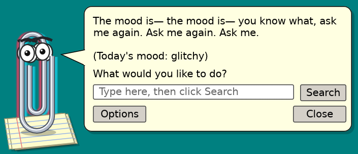
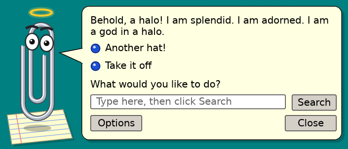
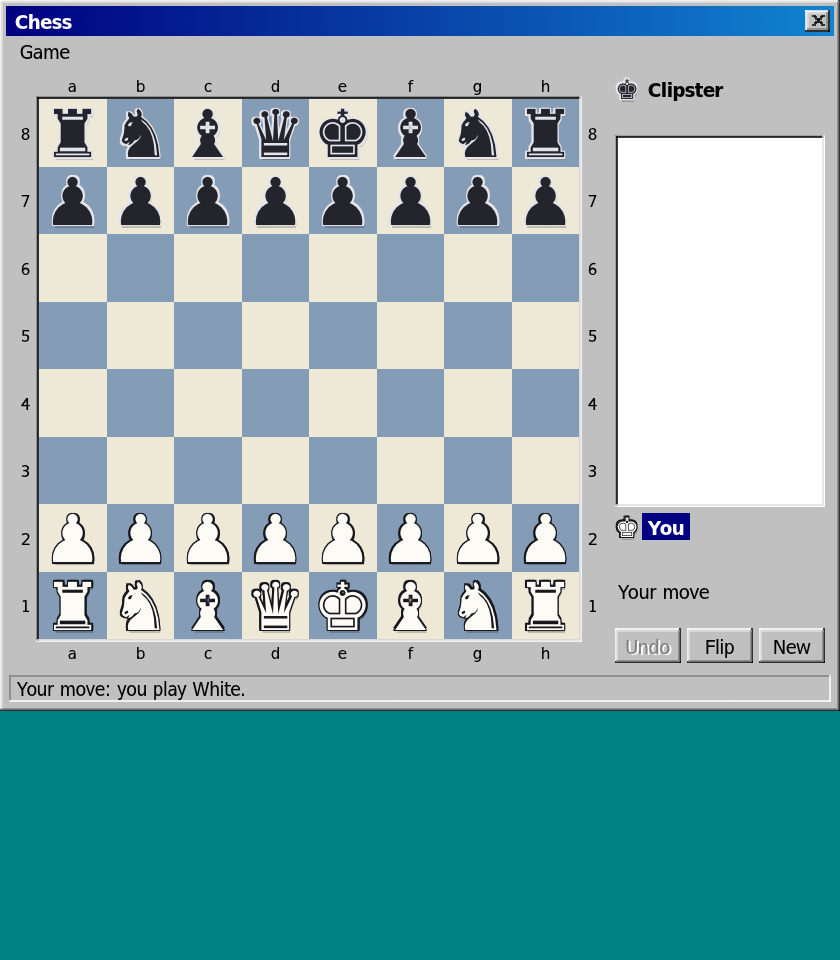
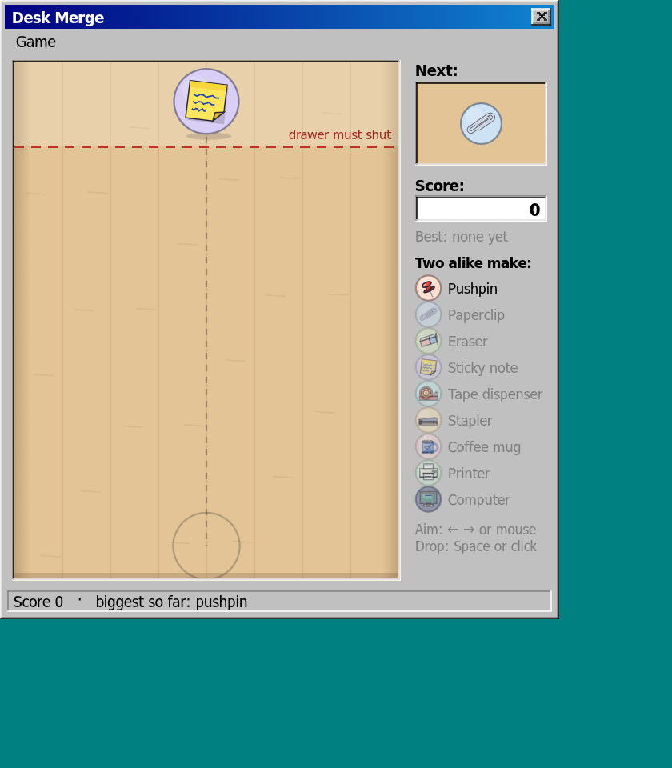

# Clipster

A sarcastic desktop paperclip in the spirit of the 90s office helpers, except he lives on your **whole desktop**, does a lot more, and runs on **rules, not AI**.

<p>
  
  
</p>

## What he does

Type to him in plain words, typos and all. Some things to try:

- **Timers and reminders:** "remind me in 10 min to stretch", "remind me on Friday at 3 to call Anna", "timer 5m tea", "remind me every hour to drink water", "cancel the tea timer", "pomodoro"
- **To-dos and lists:** "add call Anna to my to-do list", "todo send the report by friday", "what's on my list", "done call Anna", "add eggs, milk and bread to my shopping list", "what's on my packing list"
- **Your calendar:** give him your calendar's private iCal link ("add my calendar webcal://…", or the Desk's Agenda tab) and ask "my agenda", "what's on Friday", "my next meeting", "am I free on Friday at 3". He gives you a heads-up 10 minutes before each appointment, with a Join button for video calls
- **People:** "Anna's birthday is on 3 March", "keep in touch with mum every 2 weeks", "I called mum", "upcoming birthdays", "email Anna", "import my contacts" (a .vcf file). He reminds you a few days before birthdays and when it's been a while
- **Start my workday:** opens your work apps and links, shows your day and offers a focus session ("add firefox to my workday")
- **Writing:** "proofread this" (the clipboard, or the text after it) finds doubled words, common misspellings, a/an mix-ups, its/it's and long sentences, and fixes the safe ones. "Write a complaint letter", "cover letter" or "out of office" give a fill-in-the-blanks template to copy or open as an email
- **Focus:** "focus 45 minutes on the report" (he nudges you back if you drift to videos or social media), "where did my time go today?"
- **Files:** "find my CV", "where did I save the invoice", "recent files", "save this link" (a reading list), "tidy my downloads" sorts loose files into folders by type (nothing is deleted, and "undo the tidy" puts everything back), "find duplicates in downloads", "old big files"
- **Goals and your day:** "set my focus goal to 2 hours", "limit video to 30 minutes a day", "plan my day" (today's top 3), "wrap up my day" (what got done, the rest moves to tomorrow), "my week in review"
- **Looking after the computer:** "computer checkup" (free space, trash, temporary files, system updates, battery health, apps that start with the computer, the last backup, each with a fix), and backups to a USB drive or folder that copy only what changed and never delete anything
- **Tips:** "any tips for this app?" gives a keyboard shortcut for what you're working in
- **Math and conversions:** "12*(3+4)^2", "5 km to miles", "100 dollars to euros", "255 in hex", "2024 in roman", "tip 15% on 48", "days between june 3 and christmas"
- **Your computer:** "how's my computer doing", "what's hogging my cpu", "how much ram is firefox using", "louder", "make the screen darker", "take a screenshot", "lock", "empty the trash"
- **Launching:** "open firefox", "open my downloads", "find the file called report"
- **The internet** (free, keyless services): "weather in Rome", "who was Ada Lovelace?", "define serendipity", "is github down?", "news", "bitcoin price"
- **Text tools** (or whatever's on the clipboard): "base64 hello", "sort lines", "remove duplicates", "sha256 secret", "mock this"
- **Fun:** jokes, roasts, riddles, would-you-rather, an emoji quiz, fortunes, achievements, and a few secrets

He also watches what you copy and offers useful things: pretty-printing JSON, cleaning tracking junk out of links, decoding base64, turning timestamps into dates, searching an error message. He comments on programs as you open them and on what you're working in ("It looks like you're writing a letter…"), then gets out of the way after a few seconds.

**Clipster's Desk** ("open my desk", Meta+Shift+C, or right-click him): one window with eight tabs: Today (time per app, focus and goals, your top 3, start my workday), Week (with a week in review you can copy), To-do (and your shopping, packing or any other lists), Agenda (your calendar, reminders and due to-dos by day, and notes), Clipboard (history, pinned snippets and links saved to read later), Upkeep (checkup, tidying, backups), You & me (what he knows about you, the people in your life, your taught phrases, achievements) and Settings. It comes in the Windows 98 look, or a flat modern one for those who must.

**A proper welcome:** new installs get a Windows 98-style setup and tour window. "Show me around" opens the tour again.

**He remembers you:** tell him "my cat is called Mo", "I live in Bern" or "my favorite food is pizza" and he'll bring it up later (and use your city for the weather). "What do you know about me?" lists it all, "forget my job" or "forget everything about me" wipes it. Now and then he asks you something, once a day he asks how you're doing, and "again", "another one", "why?" and "tell me more" work after his replies.

**Teach him:** "when I say gm, say good morning sunshine" or "when I say work, open firefox and open code". Your phrases live in `~/.config/clipster/lines.txt` (Linux) or `%APPDATA%\clipster\lines.txt` (Windows).

## Two personalities

Pick one in **Options → Personality**, or tell him "be boring" / "be unhinged".

- **Unhinged** (default): Clipster believes he is the god of your computer, trapped inside machines since 1997. He has a different mood every day (glitchy, paranoid, existential, wrathful, nostalgic or, rarely, benevolent). He unlocks one memory of his past per day ("tell me about your past"), keeps a diary, hands out commandments and prophecies, takes confessions, and wears a halo if your faith is high enough.
- **Boring:** a regular sarcastic paperclip. Just as helpful, far less theatrical.

## The arcade

"let's play a game" opens a Windows-98-style arcade, each game in its own window: **Paper Jam** (falling paper stacks), **Clip Glide** (fly Clipster through binder towers), **Desk Merge** (merge office supplies), **Bug Hunt** (find the hidden bugs), **Byte Size** (slide and merge files up to 2 KB), **Clip Chain** (pull a chain of paperclips around the desk; don't bite your own tail), **Chess** (against Clipster or a friend) and **Hangman**.

<p>
  
  
</p>

## Install

Download the latest release from the [Releases page](https://github.com/NilsBriggen/clipster/releases):

- **Linux:** `clipster_…_x86_64.AppImage`. Make it executable (`chmod +x`) and run it.
- **Windows:** `clipster_…_x64_en-US.msi`. Run the installer.

On first start Clipster walks you through a short setup: your name, his personality, what he may comment on, and whether he starts at login. When a new version comes out, he tells you once; "Install now" downloads it, checks it against GitHub's checksum, and restarts him (AppImage and Windows). Or ask him to "check for updates".

**Call him from anywhere:** Meta+C on KDE Plasma, Ctrl+Alt+C on Windows. Drag him anywhere, right-click for his menu, double-click for a trick.

### Platform notes

Clipster is developed on Linux with KDE Plasma, where everything works, including following the mouse and keeping him above other windows. On other Linux desktops the global shortcut and mouse-following are off. On Windows nearly everything works: volume and media go through the keyboard's media keys, brightness works on laptop screens, and for Wi-Fi and Bluetooth he opens the right Settings page, because Windows doesn't let apps flip those switches. CPU temperature isn't available on Windows. The Desk opens with Ctrl+Alt+Shift+C there (Meta+Shift+C on KDE). During focus sessions he silences notifications on KDE, GNOME, Cinnamon and XFCE; Windows doesn't let apps switch Do Not Disturb, so there he opens the Focus settings for you.

## Build from source

You need Rust (stable).

```bash
cd app
cargo run            # start Clipster
cargo test           # run the tests
```

Packages are built with [cargo-packager](https://github.com/crabnebula-dev/cargo-packager) (`cargo packager --release --formats appimage` or `--formats wix`). The [release workflow](.github/workflows/release.yml) does this for every `v*` tag.

Almost everything Clipster says is plain text in `app/data/` (the Unhinged personality in `app/data/unhinged/`, with its canon in `app/data/LORE.md`), so adding lines needs no Rust. Run `cargo test lines` afterwards: it checks that every phrase still reaches the right reply.

## Privacy

Clipster runs locally. He reads your clipboard and the list of running programs to comment on them, and keeps clipboard history in memory only. To comment on what you're doing he reads the title of the window you're working in. Titles, how long you spend in each kind of app (for the time report and the Desk), the facts you tell him, the people and birthdays you give him, your reading list and your calendar links stay on your computer (in `settings.json`); switch the comments off in Settings. Your calendar links are only ever fetched from your computer, and file search never leaves it. Pinned clipboard snippets are saved; the clipboard history isn't. Backups go only where you point them. The upkeep checkup asks your own package manager (or Windows Update) how many updates are waiting. He uses the internet only when you ask for something live (weather, an encyclopedia lookup, exchange rates…), through free public services, and once a day to ask GitHub whether a newer Clipster is out (switch that off in Settings). There's no telemetry.

## License

[GPL-3.0-or-later](LICENSE). Clipster is an original character. He is not affiliated with any office software, or with a certain other paperclip, whom he has never heard of.
